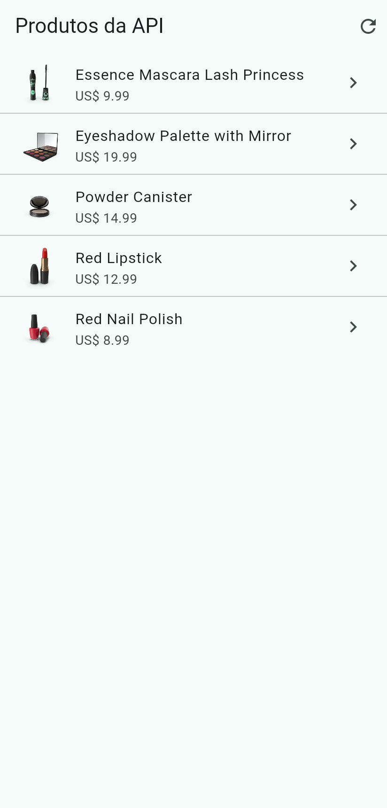
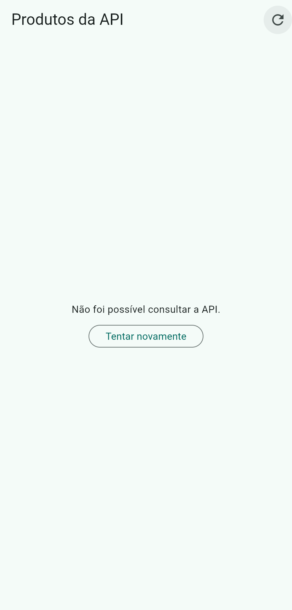

# Minha Lista de Compras — P2 de Flutter

Aplicativo Android em Flutter que consulta um catálogo de produtos na API REST da
[DummyJSON](https://dummyjson.com/docs/products), monta uma lista de compras que
funciona **sem internet** (SQLite) e restaura o **tema** e o **filtro** escolhidos
ao reabrir o app (SharedPreferences).

## Identificação

| | |
|---|---|
| Disciplina | Programação para Dispositivos Móveis — P2 de Flutter |
| Integrantes | Diego Ventura Ottani · Rafael Nunes Villa Rubia · João Alex Garcia |
| Repositório | https://github.com/DiegoOttani/p2_programacao_moveis |
| Vídeo de demonstração | _(colar o link aqui)_ |

## Como executar no Android

Pré-requisitos: Flutter **3.50+** (Dart 3.14+) e Android SDK configurado
(`flutter doctor` sem erros no Android toolchain), com um emulador aberto ou um
aparelho com depuração USB ativada.

```bash
git clone https://github.com/DiegoOttani/p2_programacao_moveis.git
cd p2_programacao_moveis
flutter pub get
flutter devices                 # copie o identificador do aparelho/emulador Android
flutter run -d ID_DO_ANDROID
```

A permissão de internet já está declarada em
`android/app/src/main/AndroidManifest.xml`, antes de `<application>`:

```xml
<uses-permission android:name="android.permission.INTERNET" />
```

Verificações automáticas:

```bash
flutter analyze   # sem problemas
flutter test      # 23 testes (modelos, serviço HTTP, SQLite e telas)
```

## De onde vem cada dado

| Recurso | O que guarda / fornece |
|---|---|
| **API REST** (DummyJSON) | Catálogo e dados da tela de detalhes: `id`, `title`, `price`, `description`, `thumbnail` via `GET https://dummyjson.com/products?limit=20`. Só é lida, nunca alterada. |
| **SQLite** (`compras.db`, tabela `itens_compra`) | Itens da lista de compras: ID do produto, nome, preço em centavos, quantidade (1–99) e estado comprado/pendente. Disponível offline. |
| **SharedPreferences** | `tema_escuro` (bool, padrão `false`) e `somente_pendentes` (bool, padrão `false`). Lidas antes do `runApp` e restauradas ao reabrir. |

Ao adicionar um produto, o app **copia** `id`, `title` e `price` da API para o SQLite
(preço gravado como `(preco * 100).round()` centavos). A partir daí, a lista não
depende mais da internet.

## Organização do código

```
lib/
├── main.dart                         inicializa o binding, lê as preferências e chama runApp
├── app.dart                          MaterialApp: estado do tema/filtro, temas claro e escuro, themeMode
├── models/
│   ├── produto_remoto.dart           JSON da API → ProdutoRemoto.fromJson
│   └── item_compra.dart              registro local: fromMap/toMap, subtotal, total, validação 1–99
├── services/
│   ├── produtos_api_service.dart     GET com timeout, status 200, valida a chave products
│   └── preferencias_service.dart     lê/grava tema_escuro e somente_pendentes
├── data/
│   └── lista_compras_repository.dart abre compras.db, cria a tabela, adicionar/listar/editar/excluir (whereArgs)
├── screens/
│   ├── home_page.dart                NavigationBar: Catálogo · Minha lista · Configurações
│   ├── catalogo_page.dart            FutureBuilder: carregando, erro + Tentar novamente, vazio, lista
│   ├── produto_detalhe_page.dart     imagem, título, preço, descrição e Adicionar à lista
│   ├── minha_lista_page.dart         itens do SQLite, quantidade, comprado/pendente, exclusão, total
│   └── configuracoes_page.dart       dois SwitchListTile (tema e filtro)
└── utils/formatacao.dart             "US$ 12,50" (duas casas, convenção do projeto)
test/                                 testes automatizados (ver acima)
```

### Regras implementadas

- **Sem duplicatas**: `produto_id` é `PRIMARY KEY`. Na inclusão, uma transação consulta o ID
  e só insere se não existir (usando o objeto `txn` nas duas operações). Se já existir, o app
  avisa *"já está na lista"* e mantém o registro atual.
- **Quantidade**: botões − / + (limitados a 1 e 99) e toque em *Qtd* para digitar. Valores fora
  de 1–99 são rejeitados no diálogo, no repositório (`ArgumentError`) e pela `CHECK` da tabela.
- **Subtotal** = preço em centavos × quantidade. **Total estimado** = soma de **todos** os itens,
  inclusive comprados e ocultos pelo filtro (cálculo com inteiros).
- **Filtro**: os itens visíveis são derivados dos registros lidos do banco. Banco vazio →
  *"Ainda não há itens na lista"*; todos ocultos → *"Não há itens pendentes"*.
- Toda gravação é aguardada (`await`) antes de recarregar a tela. *Minha lista* é relida do banco
  sempre que a aba é aberta.

## Prática guiada — Capítulo 10 (seções 1 a 9)

Passos realizados com o catálogo de exemplo do capítulo (Projeto A):

1. Abrimos `https://dummyjson.com/products?limit=12` no navegador e localizamos a lista
   `products` e os campos `id`, `title` e `price` de cada produto.
2. Executamos o catálogo do capítulo e abrimos a tela de detalhes de um produto.
3. Alteramos `limit=12` para `limit=5` em `produtos_api_service.dart`, atualizamos o catálogo
   e conferimos que aparecem **cinco produtos**.
4. Desligamos a conexão, solicitamos uma nova consulta e observamos a mensagem de erro.
   Religamos a conexão e o botão **Tentar novamente** recarregou o catálogo.

| Catálogo com `limit=5` | Mensagem de erro sem conexão |
|---|---|
|  |  |

### Como o JSON vira objetos `ProdutoRemoto`

1. `http.get` devolve uma resposta; conferimos se `statusCode == 200`.
2. `jsonDecode(utf8.decode(resposta.bodyBytes))` transforma o texto em um `Map<String, dynamic>`
   (o objeto JSON da resposta).
3. Lemos a chave `products` e verificamos se ela é uma `List`.
4. Cada elemento da lista é um `Map` de um produto; `ProdutoRemoto.fromJson` lê `id`, `title`,
   `price` (como `num`, convertido com `toDouble()`), `description` e `thumbnail` e cria o objeto
   Dart.
5. Com `.map(...).toList()` obtemos uma `List<ProdutoRemoto>`, que o `FutureBuilder` mostra na tela.

## Testes de aceitação (Android)

Preços anotados no catálogo antes dos testes: produto 1 = US$ ____ · produto 2 = US$ ____

| Teste | O que fazer | Resultado esperado | Resultado observado | Status |
|---|---|---|---|---|
| T1 | Abrir o catálogo com internet e selecionar um produto. | A lista carrega e os detalhes mostram o item escolhido. | | |
| T2 | Sem rede, forçar nova consulta. Religar e tocar em Tentar novamente. | A falha mostra mensagem e o catálogo volta a carregar. | | |
| T3 | Adicionar o mesmo produto duas vezes e abrir Minha lista. | Uma única linha para o produto, com quantidade 1. | | |
| T4 | Adicionar outro produto. Alterar o primeiro para 3. Tentar gravar 0 e 100. | Subtotal = 3 × preço. 0 e 100 rejeitados; quantidade 3 preservada. | | |
| T5 | Marcar o primeiro como comprado. Ativar o filtro de pendentes. | O primeiro some; o total inclui os dois. Sem filtro, reaparece como comprado. | | |
| T6 | Ativar tema escuro e filtro. Fechar e reabrir o app. | Tema e filtro retornam. Sem filtro, o primeiro segue comprado com quantidade 3. | | |
| T7 | Abrir Minha lista sem rede. Editar um item, cancelar uma exclusão e confirmar outra. | Edição funciona offline. Cancelar mantém; confirmar remove e atualiza o total. | | |

Os mesmos cenários de T3–T7 também são cobertos por testes automatizados em `test/`
(`flutter test`), executados com sucesso.

## Referências

- Capítulo 10 — APIs REST com Flutter (modelo `ProdutoRemoto` e serviço HTTP reaproveitados)
- https://docs.flutter.dev/cookbook/networking/fetch-data
- https://docs.flutter.dev/cookbook/persistence/sqlite
- https://pub.dev/packages/shared_preferences
- https://dummyjson.com/docs/products
